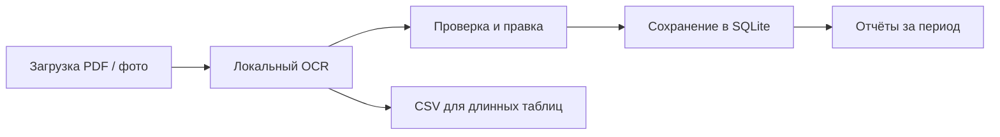

<h1 align="center">InvoiceFlowBot</h1>

<p align="center">
  <strong>Telegram-бот для автоматического распознавания, редактирования и хранения счетов с локальным OCR</strong>
</p>

<p align="center">
  <a href="https://github.com/AmaLS367/InvoiceFlowBot/actions/workflows/ci.yml"></a>
  <a href="https://www.python.org/downloads/"></a>
  <a href="https://telegram.org/"></a>
  <a href="docs/ru/setup-local.md"></a>
  <a href="docs/ru/database.md"></a>
  <a href="#-языки-интерфейса"></a>
  <a href="LICENSE"></a>
</p>

<p align="center">
  <a href="README.md">English</a> ·
  <strong>Русский</strong> ·
  <a href="docs/ru/index.md">Документация</a> ·
  <a href="docs/ru/screenshots.md">Скриншоты</a>
</p>

<p align="center">
  <a href="docs/assets/screenshots/InvoiceFlowBot_Contra_1600x1200_web.mp4">
    
  </a>
</p>

<p align="center">
  <sub>
    <a href="docs/assets/screenshots/InvoiceFlowBot_Contra_1600x1200_web.mp4">Смотреть демо со звуком (MP4, 1600×1200)</a>
    ·
    <a href="docs/ru/screenshots.md">Посмотреть скриншоты</a>
  </sub>
</p>

---

InvoiceFlowBot принимает PDF-счета и фотографии в Telegram, локально извлекает реквизиты и товарные позиции с помощью Docling и Tesseract (или Mindee как опционального провайдера), позволяет проверить и отредактировать черновик прямо в чате и сохраняет данные в SQLite для выборок по периодам. Длинные таблицы распознанных позиций бот может отправить в CSV.

## ✨ Возможности



| Возможность | Описание |
|-------------|----------|
| **Локальный OCR по умолчанию** | Распознавание через Docling и Tesseract на вашем сервере без оплаты за каждый документ (также поддерживается Mindee). |
| **Поддержка форматов** | PDF, JPEG, PNG и WebP. Перед загрузкой преобразуйте HEIC/HEIF в JPEG или PNG. |
| **Мультиязычный интерфейс (7 языков)** | Автоопределение языка Telegram, сохранение выбора в SQLite и локализованное меню команд. |
| **Интерактивное редактирование** | Правка поставщика, клиента, даты, номера, итогов и отдельных позиций через кнопки или команды. |
| **Автопроверка расчётов** | В черновике отмечаются значения, требующие проверки. При сохранении расхождение итоговой суммы с суммой позиций записывается в комментарий. |
| **SQLite + миграции Alembic** | Хранение счетов, позиций, комментариев, черновиков и настроек языка с версионируемой схемой. |
| **Запросы за период и CSV** | Фильтрация сохранённых счетов по датам и поставщику. Длинные таблицы позиций могут приходить в CSV до сохранения. |

## 🌐 Языки интерфейса

Интерфейс бота, inline-кнопки и меню команд Telegram поддерживают **7 языков** из коробки:

| Код | Язык | Каталог |
|-----|------|---------|
| `ru` | Русский (по умолчанию) | [`ru.json`](backend/handlers/locales/ru.json) |
| `en` | English | [`en.json`](backend/handlers/locales/en.json) |
| `de` | Deutsch | [`de.json`](backend/handlers/locales/de.json) |
| `es` | Español | [`es.json`](backend/handlers/locales/es.json) |
| `fr` | Français | [`fr.json`](backend/handlers/locales/fr.json) |
| `it` | Italiano | [`it.json`](backend/handlers/locales/it.json) |
| `pt` | Português | [`pt.json`](backend/handlers/locales/pt.json) |

Сменить язык можно командой `/language` или кнопкой **🌐 Язык**. В личном чате бот также обновит меню команд. Чтобы добавить ещё один язык, достаточно положить JSON-файл с двухбуквенным кодом ISO 639-1 в `backend/handlers/locales/` и зарегистрировать его в `LANGUAGES` в [`backend/handlers/texts.py`](backend/handlers/texts.py) — подробности в [руководстве по разработке](docs/ru/development.md).

## 🚀 Быстрый старт с Docker

> [!TIP]
> Docker-образ уже включает Python, языковые пакеты Tesseract и все зависимости для запуска.

```bash
# 1. Клонируйте репозиторий и создайте .env
git clone https://github.com/AmaLS367/InvoiceFlowBot.git
cd InvoiceFlowBot
if [ ! -e .env ]; then cp .env.example .env; fi

# 2. Укажите BOT_TOKEN в .env и подготовьте файл базы
if [ ! -e ./data.sqlite ]; then touch ./data.sqlite; fi

# 3. Запустите контейнер, если путь к базе указывает на обычный файл
test -f ./data.sqlite && mkdir -p ./logs && docker compose up --build -d

# 4. Просмотр логов
docker compose logs -f bot

# 5. Остановка
docker compose down
```

Файл базы и каталог `logs/` должны быть доступны пользователю контейнера на запись. Если `data.sqlite` оказался каталогом, см. [руководство по Docker](docs/ru/setup-docker.md).

## 💻 Локальная установка

Требуются **Python 3.11+**, **Git** и **Tesseract** (с языковыми пакетами из `OCR_LANGUAGES`, например `eng+rus`).

<details>
<summary><b>Пошаговая инструкция по установке</b></summary>

1. Клонируйте репозиторий и создайте виртуальное окружение:

   ```bash
   git clone https://github.com/AmaLS367/InvoiceFlowBot.git
   cd InvoiceFlowBot
   python -m venv .venv
   # Linux/macOS:
   source .venv/bin/activate
   # Windows PowerShell:
   # .\.venv\Scripts\Activate.ps1
   ```

2. Установите зависимости:

   ```bash
   pip install -e .
   ```

3. Создайте `.env` на основе `.env.example`:

   ```env
   BOT_TOKEN=123456:ABCDEF_your_bot_token
   OCR_PROVIDER=local
   OCR_LANGUAGES=eng+rus
   ```

   При `OCR_PROVIDER=local` счета обрабатываются локально без API-ключа OCR. Модели Docling скачиваются при первом распознавании. Для работы через Mindee задайте `OCR_PROVIDER=mindee`, `MINDEE_API_KEY` и `MINDEE_MODEL_ID`. Подробнее — в [руководстве по локальной установке](docs/ru/setup-local.md).

4. Примените миграции и запустите бота:

   ```bash
   python -m alembic -c backend/alembic.ini upgrade head
   python bot.py
   ```

</details>

## 📖 Использование

Начните с `/start`, чтобы выбрать язык и открыть интерактивное меню.

| Команда | Описание | Пример |
|---------|----------|--------|
| `/start` | Запуск бота, выбор языка и главное меню | `/start` |
| `/help` | Краткая справка по возможностям | `/help` |
| `/language` | Смена языка интерфейса и меню команд | `/language` |
| `/show` | Показать текущий черновик счёта | `/show` |
| `/save` | Сохранить текущий черновик в SQLite | `/save` |
| `/edit` | Массовая правка шапки счёта | `/edit supplier=ACME; client=Corp; date=2025-01-15` |
| `/edititem` | Правка отдельной позиции (нумерация с 1) | `/edititem 1 name=Widget; qty=5; price=10.50` |
| `/comment` | Добавить комментарий к черновику | `/comment Согласовано руководителем` |
| `/invoices` | Выборка счетов за период и по поставщику | `/invoices 2025-01-01 2025-01-31 supplier=ACME` |

Основные действия продублированы inline-кнопками: загрузка счёта, редактирование шапки и позиций, комментарии, сохранение, отчёт за период, справка и смена языка.

## 📚 Документация

| Раздел | Описание |
|--------|----------|
| [Обзор](docs/ru/overview.md) | Архитектура и компоненты системы |
| [Настройка локально](docs/ru/setup-local.md) | Установка и запуск без Docker |
| [Запуск в Docker](docs/ru/setup-docker.md) | Контейнеризация и развёртывание |
| [Конфигурация](docs/ru/config.md) | Переменные окружения |
| [База данных](docs/ru/database.md) | Структура SQLite и миграции Alembic |
| [Разработка](docs/ru/development.md) | Добавление языков, миграции и CI |
| [Тесты](docs/ru/tests.md) | Запуск тестов и проверки качества |
| [Устранение неполадок](docs/ru/troubleshooting.md) | Решение типовых проблем |
| [Скриншоты](docs/ru/screenshots.md) | Визуальные примеры работы бота |

## 📄 Лицензия

Распространяется по лицензии [Apache License 2.0](LICENSE). Copyright 2025 Ama.
