<div align="center">

<p align="center">
  
</p>

[](https://github.com/AmaLS367/InvoiceFlowBot/actions/workflows/ci.yml)
[](https://www.python.org/downloads/)
[](https://opensource.org/licenses/Apache-2.0)
[](https://github.com/astral-sh/ruff)
[](https://telegram.org/)

<p align="center">
  
  
  
</p>

---

> 🇬🇧 **English documentation:** [README.md](README.md)

</div>

<br/>

Русская документация по проекту InvoiceFlowBot.

## 📋 Описание

InvoiceFlowBot это Telegram бот для обработки инвойсов с помощью OCR.
Бот принимает PDF или изображение, локально распознаёт реквизиты счёта и сохраняет подтверждённые данные в SQLite.
Через интерфейс Telegram можно просматривать счета, редактировать шапку и позиции, добавлять комментарии и выгружать товары в CSV.

<div align="center">

## 🎯 Как это работает

```mermaid
graph LR
    A[📱 Пользователь] -->|Загружает PDF/Фото| B[🤖 Telegram Бот]
    B -->|Отправляет в OCR| C[🔍 Docling и Tesseract]
    C -->|Извлекает данные| D[✏️ Черновик]
    D -->|Редактирование| E[💾 SQLite]
    E -->|Запросы| F[📊 Отчёты]

    style A fill:#4A90E2,stroke:#2c3e50,stroke-width:2px,color:#fff
    style B fill:#50C878,stroke:#2c3e50,stroke-width:2px,color:#fff
    style C fill:#FF6B6B,stroke:#2c3e50,stroke-width:2px,color:#fff
    style D fill:#FFD93D,stroke:#2c3e50,stroke-width:2px,color:#333
    style E fill:#A8E6CF,stroke:#2c3e50,stroke-width:2px,color:#333
    style F fill:#B19CD9,stroke:#2c3e50,stroke-width:2px,color:#fff
```



<table>
<tr>
<td width="33%" align="center">

<br/>
<b>📤 Загрузка</b>
<br/>
<sub>Отправьте счёт через Telegram</sub>
</td>
<td width="33%" align="center">

<br/>
<b>🔍 Обработка</b>
<br/>
<sub>OCR извлекает данные автоматически</sub>
</td>
<td width="33%" align="center">

<br/>
<b>💾 Сохранение</b>
<br/>
<sub>Хранение в базе SQLite</sub>
</td>
</tr>
</table>

</div>

<br/>

## ✨ Возможности

| Функция | Описание | Статус |
|---------|----------|--------|
| 🤖 **OCR Обработка** | Локальное распознавание через Docling и Tesseract |  |
| 📎 **Множество форматов** | PDF, JPEG, PNG, HEIC, HEIF, WebP |  |
| ✏️ **Интерактивное редактирование** | Правка через интерфейс Telegram |  |
| 💾 **Хранение данных** | SQLite с миграциями Alembic |  |
| 📅 **Запросы по периоду** | Фильтрация по датам и поставщику |  |
| 💬 **Система комментариев** | Добавление заметок к счетам |  |
| 📊 **Экспорт CSV** | Выгрузка позиций для анализа |  |

## 🚀 Быстрый старт с Docker

> [!TIP]
> Самый быстрый способ запуска! Docker автоматически настроит все зависимости.

```powershell
# 1. Клонируйте и настройте окружение
git clone https://github.com/AmaLS367/InvoiceFlowBot.git
cd InvoiceFlowBot
Copy-Item .env.example .env

# 2. Отредактируйте .env с вашими токенами
notepad .env

# 3. Запустите бота
docker-compose up --build -d

# 4. Просмотр логов
docker-compose logs -f

# 5. Остановка
docker-compose down
```

## 🔧 Требования

- 🐍 Python 3.11+
- 🤖 Токен Telegram бота
- Tesseract с английским и русским языковыми пакетами для локальной установки. В Docker они уже включены.
- 💾 Доступ к SQLite (идет в комплекте с Python)

## 💻 Установка и запуск локально

> [!NOTE]
> Требуется Python 3.11+ и Git

<details>
<summary><b>📦 Пошаговая инструкция по установке</b></summary>

### 1. Клонируйте репозиторий

```powershell
git clone https://github.com/AmaLS367/InvoiceFlowBot.git
cd InvoiceFlowBot
```

### 2. Создайте виртуальное окружение

```powershell
python -m venv .venv
.\.venv\Scripts\Activate.ps1
```

### 3. Установите зависимости

```powershell
pip install -e .
```

### 4. Настройте переменные окружения

```powershell
Copy-Item .env.example .env
notepad .env
```

**Пример `.env`:**
```env
BOT_TOKEN=123456:ABCDEF_your_bot_token
OCR_PROVIDER=local
OCR_LANGUAGES=eng+rus
```

При `OCR_PROVIDER=local` счета обрабатываются на сервере бота без API-ключа OCR и платы за документ. При первой обработке скачиваются модели Docling. Для Mindee укажите `OCR_PROVIDER=mindee`, `MINDEE_API_KEY` и `MINDEE_MODEL_ID`. Подробности в [руководстве по локальной установке](docs/ru/setup-local.md).

### 5. Запустите бота

```powershell
python bot.py
```

> [!TIP]
> Логи по умолчанию пишутся в каталог `logs/` - проверьте их при возникновении проблем.

</details>

## 📚 Документация

<details>
<summary><b>📖 Полное руководство (docs/ru/)</b></summary>

| Раздел | Описание |
|--------|----------|
| 📖 [Обзор](docs/ru/overview.md) | Архитектура и компоненты системы |
| 💻 [Настройка локально](docs/ru/setup-local.md) | Установка без Docker |
| 🐳 [Запуск в Docker](docs/ru/setup-docker.md) | Контейнеризация и развертывание |
| ⚙️ [Конфигурация](docs/ru/config.md) | Переменные окружения |
| 🗄️ [База данных](docs/ru/database.md) | Структура SQLite и миграции |
| 🧪 [Тесты](docs/ru/tests.md) | Запуск тестов и проверки качества |
| 🔧 [Устранение неполадок](docs/ru/troubleshooting.md) | Решение типовых проблем |
| 📸 [Скриншоты](docs/ru/screenshots.md) | Визуальные примеры |

> [!NOTE]
> 🇬🇧 Английская версия документации: [README.md](README.md)

</details>

---

<div align="center">

### 🌟 История звёзд

[](https://star-history.com/#AmaLS367/InvoiceFlowBot&Date)


**Сделано с ❤️ от [Ama](https://github.com/AmaLS367)**

</div>
