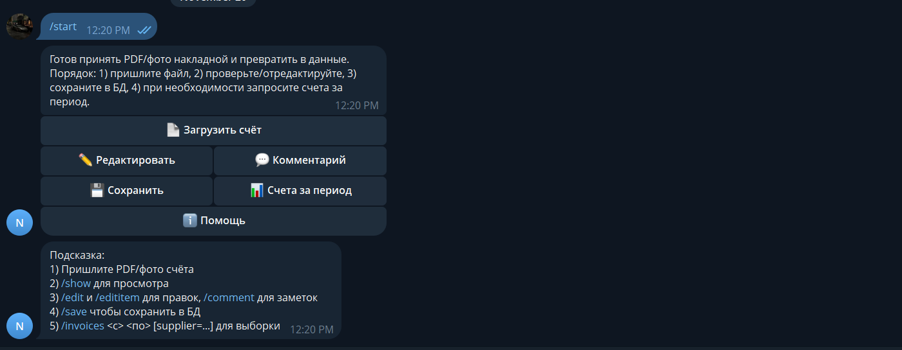
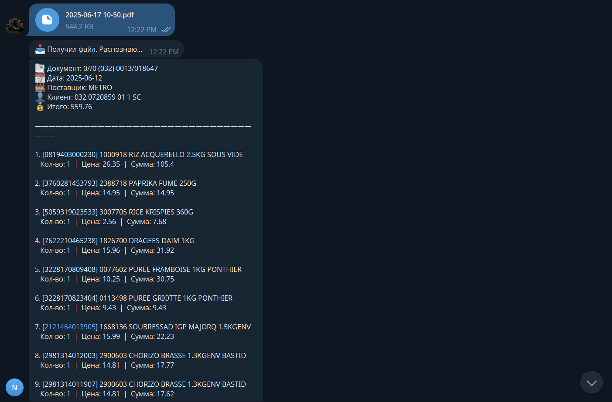
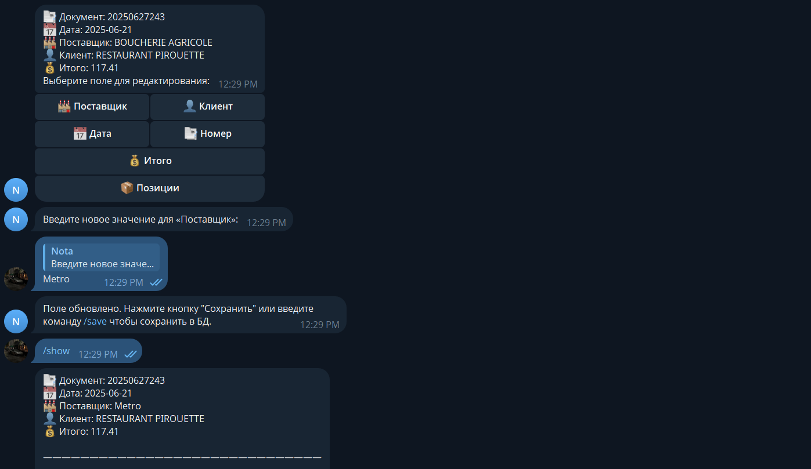
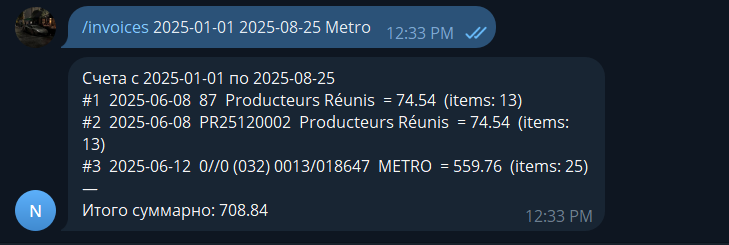

  

## 📖 О скриншотах

Ниже — визуальный пример полного цикла: от старта диалога до запроса сохраненных счетов. Используйте эти кадры как быстрый ориентир по UX.

## Стартовый экран и меню

Пользователь запускает `/start`, видит клавиатуру и основные действия.

## Распознавание PDF/фото накладной

Бот принимает файл, распознаёт его и показывает распознанные поля.

## Редактирование данных счёта

Через команды и кнопки можно поправить шапку, позиции или комментарии перед сохранением.

## Счета за период и итоговая сумма

Команда `/invoices` возвращает список сохраненных документов за выбранный период с подсчетом суммы.

